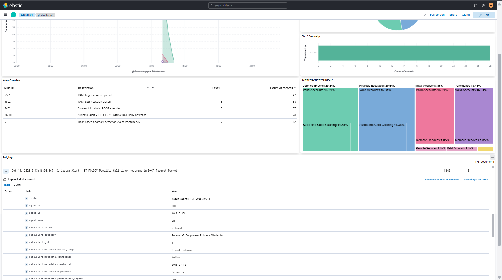

# SOC Analyst Homelab — Wazuh & Suricata

A hands-on Security Operations Center (SOC) homelab built to practice security monitoring, centralized log analysis, intrusion detection, and file integrity monitoring in a virtualized environment.

## Overview

This project simulates a small SOC environment using Wazuh as the SIEM platform and Suricata as the network intrusion detection system (IDS). The lab is designed to help develop practical skills in security event monitoring, alert analysis, detection validation, and incident documentation.

## Lab Environment

| Component | Description |
|---|---|
| SIEM | Wazuh Manager 4.5.4 |
| Endpoint Agent | Wazuh Agent 4.5.4 |
| Network IDS | Suricata |
| Target Server | Ubuntu Server 20.04.5 LTS |
| Testing Machine | Kali Linux |
| Virtualization | Oracle VirtualBox |
| Remote Access | SSH via MobaXterm |

## Lab Architecture

The lab consists of three virtual machines connected through an isolated VirtualBox Internal Network.

| Virtual Machine | Role | Internal IP |
|---|---|---|
| Wazuh Server | SIEM and alert management | `192.168.77.10` |
| Target Server | Monitored endpoint running Wazuh Agent and Suricata | `192.168.77.20` |
| Kali Linux | Security testing machine | `192.168.77.30` |

**Log and detection workflow:**

1. The target server generates system and security events.
2. Suricata monitors network traffic and generates IDS events.
3. Wazuh Agent forwards monitored events to Wazuh Manager.
4. Wazuh analyzes events using decoders and detection rules.
5. Alerts are reviewed in the Wazuh dashboard for investigation and validation.

## Detection Validation Evidence

The following screenshots document the detection tests performed in the lab.

### 1. Custom Wazuh Rule — Rule ID `100300`

**Objective:** Validate detection of a custom test event generated on the monitored endpoint.

A test message was written to the target server's system log and successfully detected by Wazuh using custom rule `100300`.

### 2. Suricata Alert Ingestion — Rule ID `86601`

**Objective:** Verify that Suricata events are collected and detected by Wazuh.

A Suricata event was observed in Wazuh, confirming that the IDS event log was being ingested and processed.

### 3. File Integrity Monitoring — File Added (Rule ID `554`)

**Objective:** Validate detection of file creation on the monitored endpoint.

A test file was created in the monitored home directory. Wazuh generated a file-added alert.

### 4. File Integrity Monitoring — File Modified (Rule ID `550`)

**Objective:** Validate detection of changes to a monitored file.

The test file was modified, and Wazuh generated an integrity-change alert.

## Current Progress

### Completed

- [x] Deploy Wazuh Manager and dashboard
- [x] Install Wazuh Agent on the target server
- [x] Configure connectivity across the internal lab network
- [x] Validate endpoint event ingestion
- [x] Validate custom Wazuh rule `100300`
- [x] Observe Suricata alert ingestion through rule `86601`
- [x] Validate file creation detection through rule `554`
- [x] Validate file modification detection through rule `550`
- [x] Document initial detection evidence

### In Progress / Planned

- [ ] Verify file-integrity alert details, including the affected file path
- [ ] Verify Who-data attribution for file changes
- [ ] Investigate the earlier audit event-dispatch warning
- [ ] Test and document custom Suricata rule `100200`
- [ ] Validate Wazuh Active Response in the isolated lab
- [ ] Document investigation steps, findings, and response outcomes

## Learning Objectives

- Understand SIEM and IDS workflows
- Collect and analyze endpoint and network security logs
- Investigate alerts and suspicious activity
- Validate detection rules using controlled test events
- Understand file integrity monitoring and audit event collection
- Practice incident investigation and technical documentation

## Tools and Technologies

- Wazuh
- Suricata
- Ubuntu Server
- Kali Linux
- Oracle VirtualBox
- Linux system logging and audit tools
- Git and GitHub

## Disclaimer

This project is intended for educational purposes in an isolated lab environment. All security testing is performed only on systems owned by me or for which I have explicit authorization.

