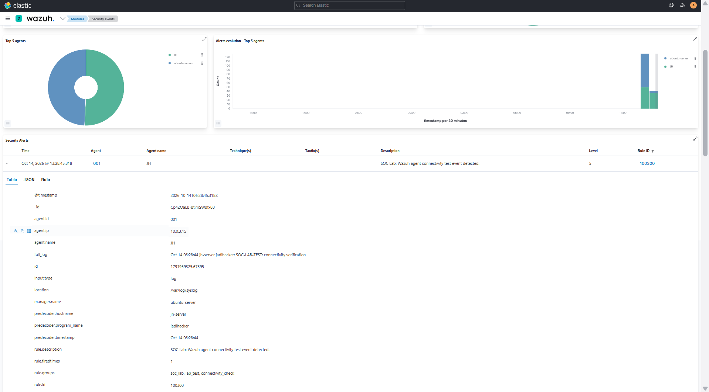
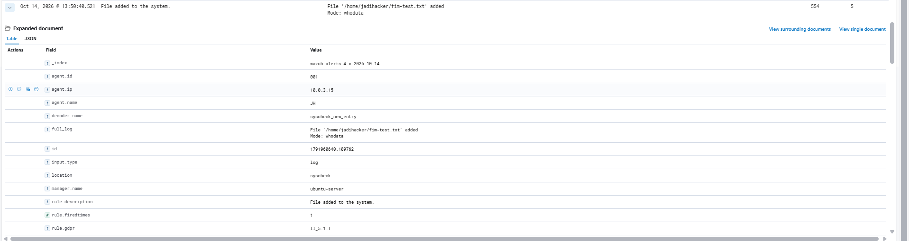
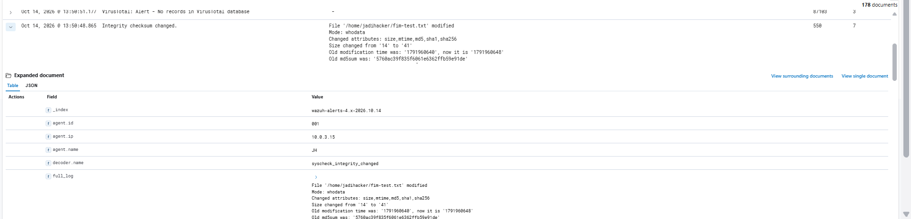

# SOC Homelab: Wazuh & Suricata

## Overview
A hands-on Security Operations Center (SOC) homelab built to practice security monitoring, log analysis, and threat detection in a virtualized environment.

## Lab Environment
- **SIEM:** Wazuh Manager 4.5.4
- **IDS:** Suricata
- **Target:** Ubuntu Server 20.04.5 LTS
- **Attacker / Testing VM:** Kali Linux
- **Virtualization:** Oracle VirtualBox
- **Remote Access:** SSH via MobaXterm

## Lab Architecture
The environment consists of three virtual machines connected through an isolated internal network.

- Wazuh Manager: `192.168.77.10`
- Target Server: `192.168.77.20`
- Kali Linux: `192.168.77.30`

## Current Progress
- [x] Deployed Wazuh Manager
- [x] Installed Wazuh Agent on the target server
- [x] Configured internal lab network connectivity
- [x] Troubleshot disk-space exhaustion affecting the Wazuh Agent
- [ ] Verify agent connectivity and event ingestion
- [ ] Generate test security events
- [ ] Analyze alerts in the Wazuh dashboard
- [ ] Document detection and investigation findings

## Learning Objectives
- Understand SIEM and IDS workflows
- Collect and analyze security logs
- Investigate alerts and suspicious activity
- Practice incident investigation and documentation

## Disclaimer
This project is for educational purposes in an isolated lab environment. All security testing is intended to be performed on systems I own or am authorized to test.

## Detection Validation Evidence

The following screenshots demonstrate successful event ingestion and detection in the SOC homelab using Wazuh and Suricata.

### 1. Custom Wazuh Rule — Rule ID 100300
Validates that a custom Wazuh rule detects a test connectivity event from the monitored endpoint.

### 2. Suricata Alert Ingestion — Rule ID 86601
Demonstrates a Suricata security event being ingested and detected by Wazuh.

### 3. File Integrity Monitoring — File Added (Rule ID 554)
Demonstrates Wazuh detecting a newly created file on the monitored endpoint.

### 4. File Integrity Monitoring — File Modified (Rule ID 550)
Demonstrates Wazuh detecting an integrity change after a monitored file is modified.

