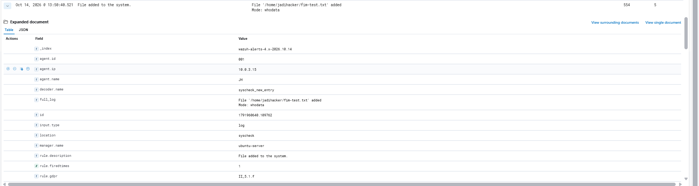
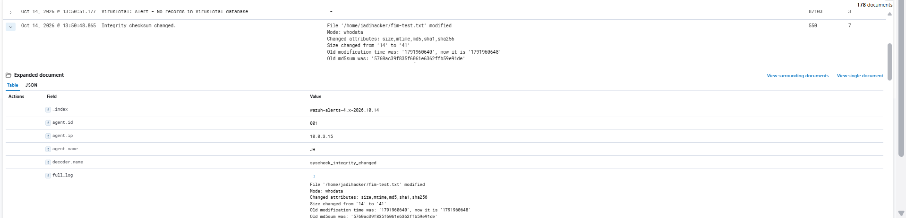

# Pemantauan Integritas File (FIM)

## 1. Tujuan

Memvalidasi kemampuan Wazuh File Integrity Monitoring (FIM) dalam mendeteksi pembuatan dan perubahan file pengujian pada direktori endpoint yang dipantau.

## 2. Konfigurasi Lab

| Komponen | Detail |
|---|---|
| Endpoint | Ubuntu Server (`192.168.77.20`) |
| Wazuh Agent | `jh-server` |
| SIEM | Wazuh 4.14.9 |
| Direktori pengujian | `/home/jadihacker` |

## 3. Prosedur Pengujian

Dua operasi file dilakukan secara terkontrol pada endpoint Ubuntu:

1. Membuat file pengujian baru di dalam direktori yang dipantau.
2. Memodifikasi file pengujian yang sama untuk mengubah isinya.

Wazuh FIM memantau aktivitas tersebut dan menghasilkan event keamanan yang sesuai.

## 4. Hasil Deteksi

| Wazuh Rule ID | Jenis Deteksi |
|---|---|
| `554` | File ditambahkan ke sistem |
| `550` | Checksum integritas file mengalami perubahan |

Hasil tersebut menunjukkan bahwa Wazuh dapat mendeteksi aktivitas penambahan file dan perubahan integritas file pada direktori yang dipantau.

## 5. Bukti Pengujian

### Deteksi Pembuatan File

### Deteksi Perubahan File

## 6. Kesimpulan

Wazuh berhasil menghasilkan alert FIM ketika sebuah file pengujian dibuat dan kemudian dimodifikasi pada direktori endpoint yang dipantau.

Hasil pengujian ini memvalidasi fungsi dasar pemantauan penambahan file dan perubahan integritas file. Namun, atribusi jalur file secara spesifik (*exact file-path attribution*) dan atribusi menggunakan Who-data masih memerlukan pengujian terpisah.
