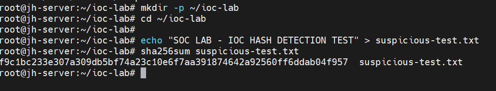
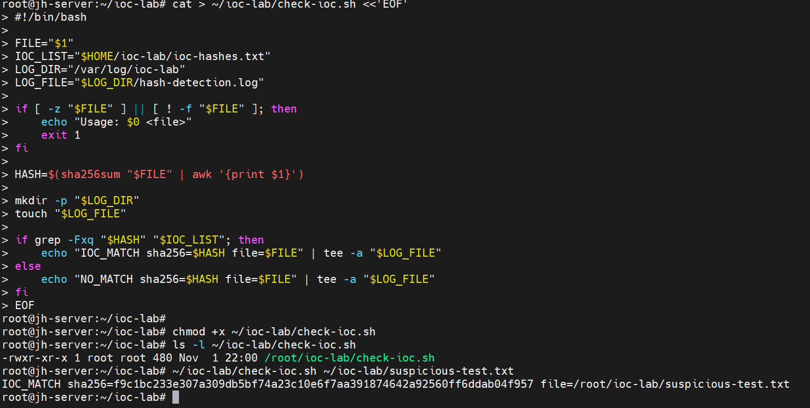
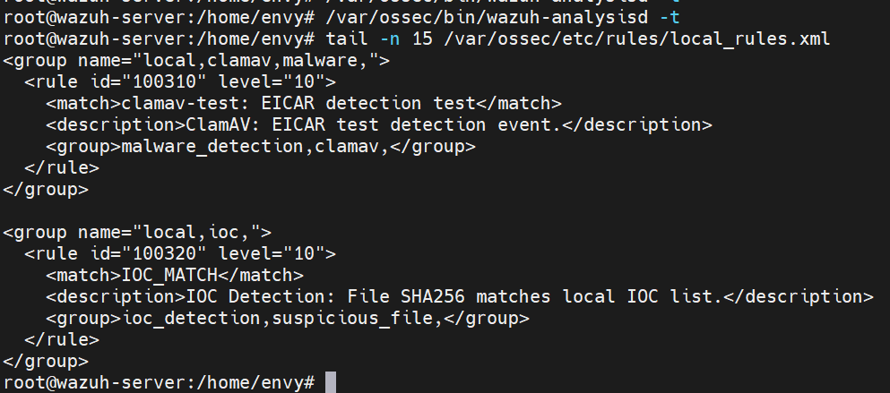
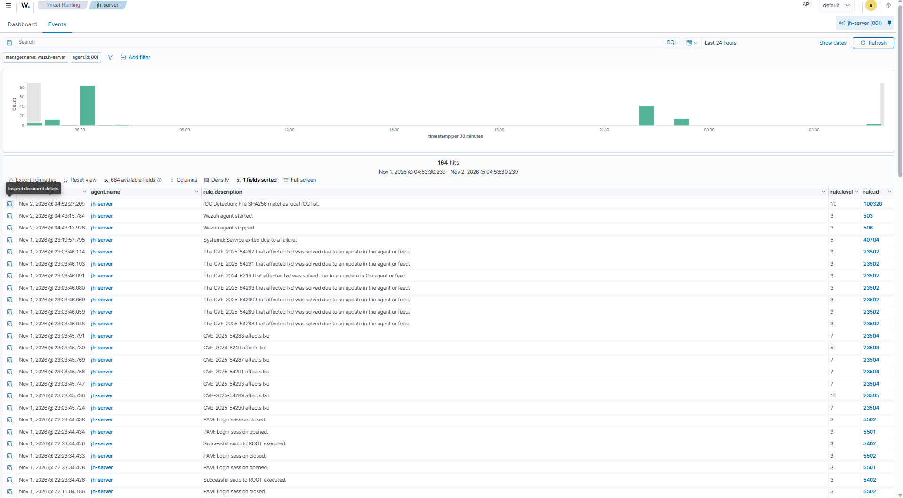
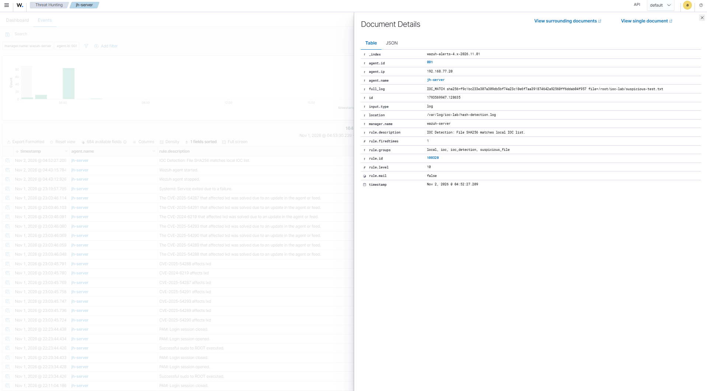

# Deteksi IOC / Hash File Mencurigakan

## 1. Tujuan

Pengujian ini bertujuan untuk mengimplementasikan mekanisme deteksi *Indicator of Compromise* (IOC) berdasarkan hash SHA-256 file dan mengintegrasikannya dengan Wazuh.

Mekanisme deteksi menggunakan script Bash untuk menghitung hash file, membandingkannya dengan daftar IOC lokal, kemudian mencatat hasil pemeriksaan ke dalam file log yang dipantau oleh Wazuh Agent.

## 2. Lingkungan Pengujian

| Komponen | Konfigurasi |
|---|---|
| Wazuh Manager | 192.168.77.10 |
| Target Server | Ubuntu Server 20.04.5 LTS |
| IP Target | 192.168.77.20 |
| Wazuh Agent | jh-server |
| Algoritma Hash | SHA-256 |
| Script Deteksi | check-ioc.sh |
| Daftar IOC | ioc-hashes.txt |
| File Log | /var/log/ioc-lab/hash-detection.log |

## 3. Pembuatan IOC Hash

Pengujian dilakukan dengan membuat file bernama `suspicious-test.txt` pada server target. Hash SHA-256 dari file tersebut dihitung menggunakan perintah `sha256sum`, kemudian dimasukkan ke dalam daftar IOC lokal bernama `ioc-hashes.txt`.

Hash yang digunakan dalam pengujian:

| Atribut | Nilai |
|---|---|
| Nama File | suspicious-test.txt |
| Algoritma | SHA-256 |
| Nilai Hash | `f9c1bc233e307a309db5bf74a23c10e6f7aa391874642a92560ff6ddab04f957` |
| Daftar IOC | ioc-hashes.txt |

Hash tersebut merupakan IOC simulasi yang dibuat khusus untuk kebutuhan pengujian di lingkungan lab. Hash ini bukan indikator malware yang telah diverifikasi.

**Bukti Pembuatan File dan Daftar IOC**

## 4. Implementasi Script Deteksi

Script Bash `check-ioc.sh` dibuat untuk melakukan pemeriksaan hash file terhadap daftar IOC lokal.

Proses yang dilakukan oleh script meliputi:

1. Menerima lokasi file sebagai input.
2. Menghitung hash SHA-256 dari file.
3. Membandingkan hasil hash dengan isi `ioc-hashes.txt`.
4. Menghasilkan status `IOC_MATCH` apabila hash ditemukan dalam daftar IOC, atau `NO_MATCH` apabila tidak ditemukan.
5. Menyimpan hasil pemeriksaan ke dalam `/var/log/ioc-lab/hash-detection.log`.

Script kemudian diberikan izin eksekusi dan diuji menggunakan file yang memiliki hash sesuai daftar IOC.

Pengujian juga dilakukan menggunakan file normal dengan hash yang tidak terdapat dalam daftar IOC untuk memastikan mekanisme pencocokan dapat membedakan kedua kondisi tersebut.

**Bukti Validasi Script Deteksi IOC**

## 5. Integrasi dengan Wazuh

Wazuh Agent pada server target dikonfigurasi untuk memantau file log hasil pemeriksaan IOC:

`/var/log/ioc-lab/hash-detection.log`

Pemantauan dilakukan menggunakan konfigurasi `localfile` dengan format log `syslog` pada file konfigurasi Wazuh Agent.

Pada sisi Wazuh Manager, dibuat custom rule pada file `/var/ossec/etc/rules/local_rules.xml` untuk mengenali event yang mengandung teks `IOC_MATCH`.

Detail custom rule:

| Atribut | Nilai |
|---|---|
| Rule ID | 100320 |
| Level | 10 |
| Deskripsi | IOC Detection: File SHA256 matches local IOC list. |
| Group | ioc_detection, suspicious_file |
| Kondisi Pencocokan | IOC_MATCH |

Konfigurasi rule divalidasi menggunakan perintah `wazuh-analysisd -t`. Pengujian rule juga dilakukan menggunakan `wazuh-logtest` untuk memastikan event yang sesuai dapat dikenali oleh Wazuh.

**Bukti Validasi Custom Rule Wazuh**

## 6. Hasil Pengujian

Pengujian dilakukan dalam dua kondisi untuk memvalidasi mekanisme pencocokan hash.

| Skenario | File Pengujian | Hasil |
|---|---|---|
| Positive Test | suspicious-test.txt | IOC_MATCH |
| Negative Test | normal-test.txt | NO_MATCH |

Pada *positive test*, hash file ditemukan dalam daftar IOC sehingga script menghasilkan status `IOC_MATCH`.

Sebaliknya, pada *negative test*, hash file tidak ditemukan dalam daftar IOC sehingga script menghasilkan status `NO_MATCH`.

Setelah pengujian positif dilakukan, Wazuh Agent berhasil mengirimkan event dari server target ke Wazuh Manager. Wazuh Manager kemudian menghasilkan alert menggunakan Rule ID `100320` dengan Level 10.

### 6.1 Alert Deteksi IOC pada Dashboard Wazuh

### 6.2 Detail Alert Wazuh

Detail alert yang teramati:

| Atribut | Hasil |
|---|---|
| Nama Agent | jh-server |
| IP Agent | 192.168.77.20 |
| Rule ID | 100320 |
| Rule Level | 10 |
| Lokasi Log | /var/log/ioc-lab/hash-detection.log |

## 7. Kesimpulan

Mekanisme deteksi IOC berdasarkan hash SHA-256 berhasil diimplementasikan dan divalidasi pada lingkungan lab.

Script Bash berhasil mengidentifikasi file dengan hash yang sesuai dengan daftar IOC serta membedakannya dari file yang tidak memiliki kecocokan. Wazuh Agent juga berhasil mengirimkan event deteksi ke Wazuh Manager, yang kemudian menghasilkan alert menggunakan custom Rule ID `100320` dengan Level 10.

Pengujian ini menunjukkan implementasi dasar mekanisme pencocokan hash IOC lokal dan integrasinya dengan Wazuh. Hash yang digunakan merupakan hash simulasi untuk kebutuhan pengujian, bukan hash malware yang telah diverifikasi.