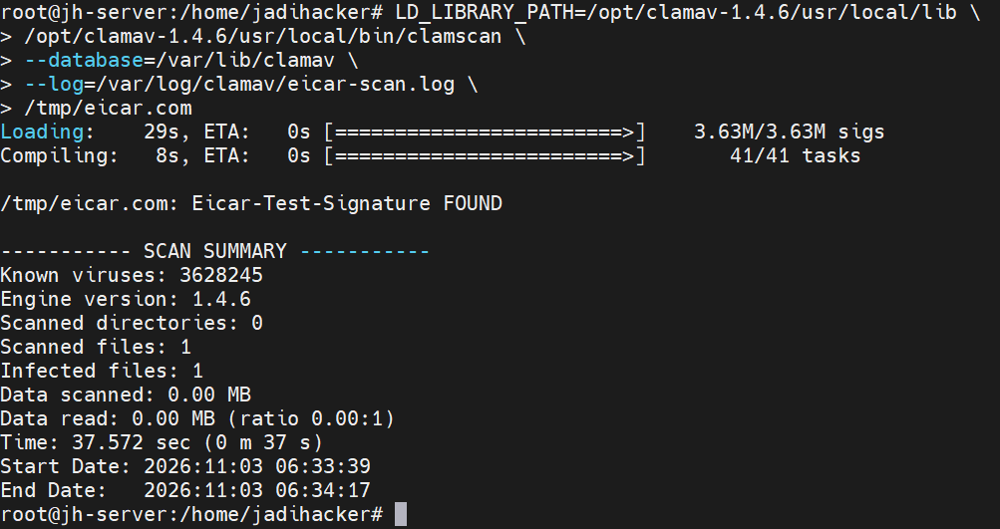
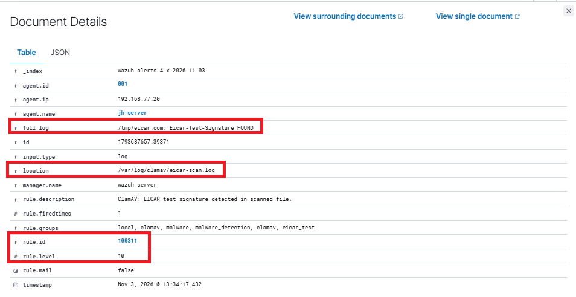

# Case 2 — Malware Detection

## 2.1 ClamAV EICAR Detection

**Tujuan:** Memvalidasi kemampuan ClamAV dalam mendeteksi file uji antivirus EICAR serta memastikan hasil pemindaian diteruskan ke Wazuh untuk menghasilkan alert.

Pengujian dilakukan pada Ubuntu Server (`jh-server`) menggunakan ClamAV 1.4.6. File `/tmp/eicar.com` digunakan sebagai file uji EICAR. EICAR merupakan string pengujian antivirus yang aman dan bukan malware aktif.

### Lingkungan Pengujian

| Komponen | Detail |
|---|---|
| Mesin pengujian | Ubuntu Server |
| Hostname | `jh-server` |
| IP Target | `192.168.77.20` |
| Wazuh Agent | `jh-server` (Agent ID `001`) |
| Antivirus | ClamAV 1.4.6 |
| File uji | `/tmp/eicar.com` |
| File log | `/var/log/clamav/eicar-scan.log` |

### Proses Pengujian

Pemindaian dilakukan menggunakan database signature ClamAV yang telah diperbarui.

```bash
LD_LIBRARY_PATH=/opt/clamav-1.4.6/usr/local/lib \
/opt/clamav-1.4.6/usr/local/bin/clamscan \
--database=/var/lib/clamav \
--log=/var/log/clamav/eicar-scan.log \
/tmp/eicar.com
```

Hasil pemindaian menunjukkan:

```text
/tmp/eicar.com: Eicar-Test-Signature FOUND

----------- SCAN SUMMARY -----------
Engine version: 1.4.6
Scanned files: 1
Infected files: 1
```

Hasil tersebut membuktikan bahwa ClamAV berhasil mengenali signature uji EICAR pada file yang dipindai.

**Bukti pemindaian ClamAV**



### Integrasi dengan Wazuh

Wazuh Agent pada Ubuntu Server dikonfigurasi untuk memantau file log:

`/var/log/clamav/eicar-scan.log`

Pada Wazuh Manager, rule lokal `100311` ditambahkan untuk mencocokkan baris hasil deteksi ClamAV:

```text
Eicar-Test-Signature FOUND
```

Konfigurasi rule:

```xml
<rule id="100311" level="10">
  <match>Eicar-Test-Signature FOUND</match>
  <description>ClamAV: EICAR test signature detected in scanned file.</description>
  <group>malware_detection,clamav,eicar_test,</group>
</rule>
```

Setelah konfigurasi divalidasi dan Wazuh Manager direstart, pemindaian EICAR dijalankan kembali. Wazuh menerima event dari file log ClamAV dan menghasilkan alert dengan detail berikut:

| Parameter | Hasil |
|---|---|
| Agent Name | `jh-server` |
| Agent ID | `001` |
| Agent IP | `192.168.77.20` |
| Rule ID | `100311` |
| Rule Level | `10` |
| Rule Description | `ClamAV: EICAR test signature detected in scanned file.` |
| Log Location | `/var/log/clamav/eicar-scan.log` |
| Full Log | `/tmp/eicar.com: Eicar-Test-Signature FOUND` |
| Rule Fired Times | `1` |

**Bukti alert ClamAV pada Wazuh Dashboard**



### Analisis Hasil

Berdasarkan hasil pengujian, ClamAV berhasil mendeteksi signature EICAR dan menuliskan hasil pemindaian ke file log. Wazuh Agent kemudian mengirimkan event tersebut ke Wazuh Manager. Rule lokal `100311` berhasil mengenali event dan menghasilkan alert Level 10 pada Wazuh Dashboard.

Dengan demikian, alur integrasi ClamAV ke Wazuh berhasil divalidasi menggunakan file uji EICAR.

**Catatan:** Pengujian ini memvalidasi deteksi terhadap file uji EICAR. Hasil ini tidak dapat dijadikan bukti bahwa malware aktif atau sampel malware nyata berhasil dideteksi. Rule `100310` yang sebelumnya digunakan untuk event uji manual tetap dipertahankan dan berbeda dari Rule `100311` yang mencocokkan hasil pemindaian ClamAV.