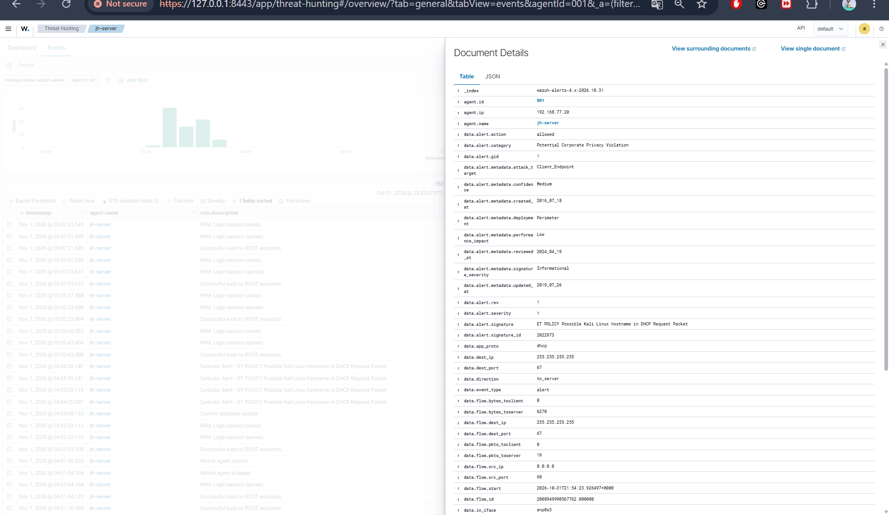
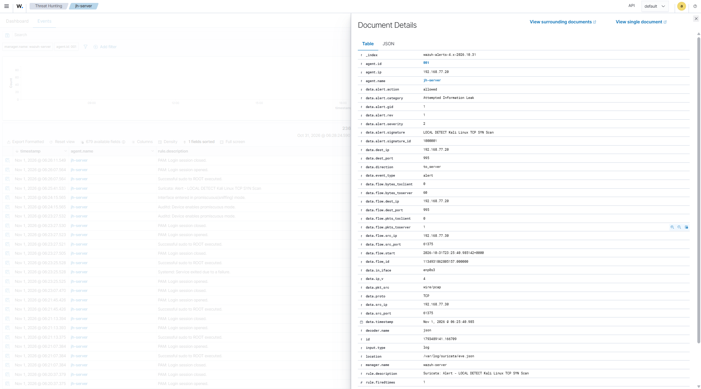

# Deteksi Intrusi Jaringan — Suricata dan Wazuh

## 1. Tujuan

Memvalidasi kemampuan Suricata dalam mendeteksi aktivitas pemindaian TCP SYN yang dilakukan secara terkontrol serta memastikan bahwa alert yang dihasilkan diteruskan dan diproses oleh Wazuh.

## 2. Konfigurasi Lab

| Komponen | Detail |
|---|---|
| Mesin sumber | Kali Linux (`192.168.77.30`) |
| Server target | Ubuntu Server (`192.168.77.20`) |
| Antarmuka jaringan | `enp0s3` |
| IDS | Suricata 8.0.4 |
| SIEM | Wazuh 4.14.9 |

## 3. Prosedur Pengujian

Pemindaian TCP SYN dilakukan dari Kali Linux menuju server Ubuntu menggunakan Nmap dengan perintah berikut:

```bash
nmap -sS -T3 --top-ports 100 192.168.77.20
```

Sebuah custom rule Suricata dikonfigurasi untuk mendeteksi minimal 10 paket TCP SYN dari alamat IP sumber Kali Linux dalam rentang waktu 10 detik.

## 4. Hasil Deteksi

| Komponen Deteksi | Hasil |
|---|---|
| Suricata Custom Signature ID | `1000001` |
| Suricata Signature | `LOCAL DETECT Kali Linux TCP SYN Scan` |
| Wazuh Rule ID | `86601` |
| Level Alert Wazuh | `3` |
| Source IP | `192.168.77.30` |
| Destination IP | `192.168.77.20` |
| Log Event | `/var/log/suricata/eve.json` |

Suricata berhasil menghasilkan alert berdasarkan trafik pengujian. Event tersebut dikumpulkan oleh Wazuh Agent dan diproses oleh Wazuh Manager menggunakan Rule ID `86601`.

Hasil ini menunjukkan bahwa integrasi pengiriman event dari Suricata ke Wazuh berjalan dengan baik.

## 5. Bukti Pengujian

### Alert Suricata pada Wazuh



### Deteksi Pemindaian TCP SYN



## 6. Kesimpulan

Aktivitas pemindaian TCP SYN yang dilakukan secara terkontrol berhasil dideteksi oleh custom rule Suricata. Event yang dihasilkan juga berhasil diteruskan dan diproses oleh Wazuh.

Pengujian ini memvalidasi integrasi event Suricata ke Wazuh serta fungsi rule deteksi yang dikonfigurasi di lingkungan lab. Aktivitas tersebut merupakan simulasi *network reconnaissance* yang terkontrol, bukan bukti terjadinya serangan nyata.

Suricata berjalan dalam mode IDS. Status aksi alert adalah `allowed`, yang berarti trafik berhasil dideteksi tetapi tidak diblokir.
