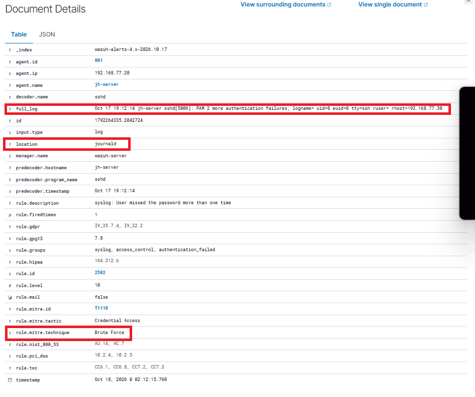
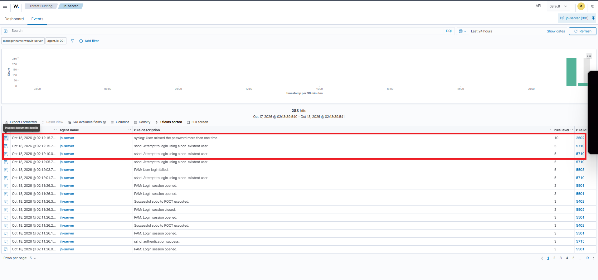
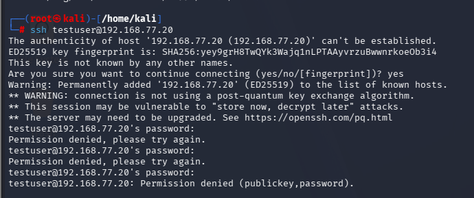
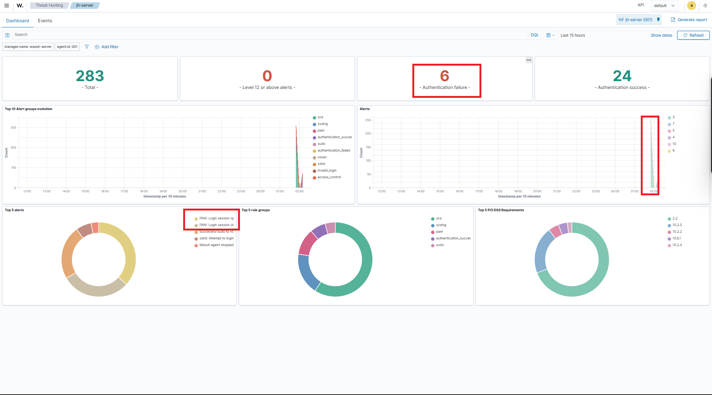

# Deteksi Kegagalan Autentikasi SSH

## 1. Tujuan

Memvalidasi kemampuan Wazuh dalam mengumpulkan log autentikasi SSH dan menghasilkan alert ketika terjadi percobaan login gagal yang dilakukan secara terkontrol.

## 2. Konfigurasi Lab

| Komponen | Detail |
|---|---|
| Mesin sumber | Kali Linux (`192.168.77.30`) |
| Server target | Ubuntu Server (`192.168.77.20`) |
| Wazuh Agent | `jh-server` |
| SIEM | Wazuh 4.14.9 |

## 3. Prosedur Pengujian

Pengujian kegagalan autentikasi SSH dilakukan dari Kali Linux menuju server Ubuntu sebagai target.

Percobaan login dilakukan secara sengaja menggunakan autentikasi yang tidak valid untuk menghasilkan event kegagalan autentikasi SSH/PAM. Event tersebut kemudian dikumpulkan oleh Wazuh Agent dan dikirim ke Wazuh Manager untuk dianalisis.

## 4. Hasil Deteksi

Berdasarkan hasil pengujian, Wazuh menghasilkan beberapa alert terkait kegagalan autentikasi SSH:

| Wazuh Rule ID | Level | Deskripsi |
|---|---:|---|
| `2502` | 10 | PAM 2 more authentication failures |
| `5710` | 5 | Percobaan login menggunakan pengguna yang tidak ditemukan |
| `5503` | 5 | Kegagalan login PAM |

**MITRE ATT&CK:** `T1110` — Brute Force, sebagaimana ditampilkan pada alert terkait.

Alert tersebut menunjukkan bahwa Wazuh berhasil mengenali beberapa jenis event kegagalan autentikasi selama pengujian.

## 5. Bukti Pengujian

### Alert Kegagalan Autentikasi SSH pada Wazuh

### Event Kegagalan Autentikasi

### Simulasi Kegagalan Login SSH dari Kali Linux

### Ringkasan Autentikasi pada Dashboard Wazuh

## 6. Kesimpulan

Wazuh berhasil mengumpulkan event kegagalan autentikasi SSH dari server Ubuntu dan menghasilkan alert keamanan yang sesuai dengan aktivitas pengujian.

Pengujian ini merupakan simulasi kegagalan autentikasi yang dilakukan secara terkontrol di lingkungan lab. Hasil tersebut membuktikan bahwa mekanisme pengumpulan log dan deteksi kegagalan autentikasi SSH berjalan, tetapi tidak membuktikan bahwa serangan brute-force sungguhan telah terjadi.
