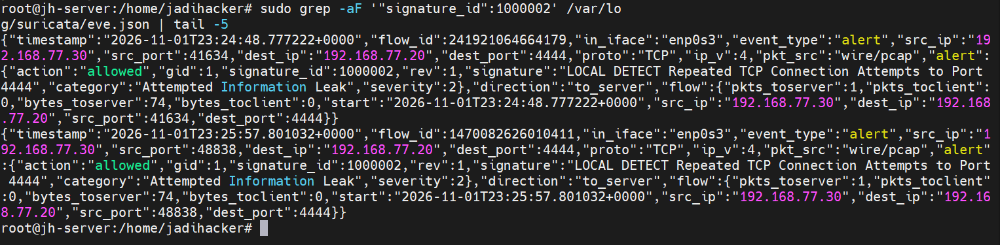
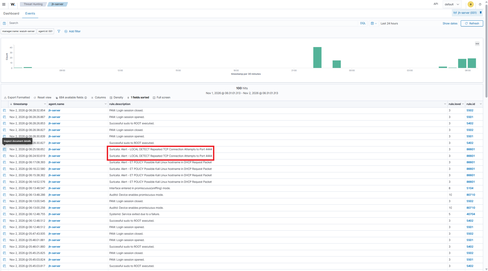
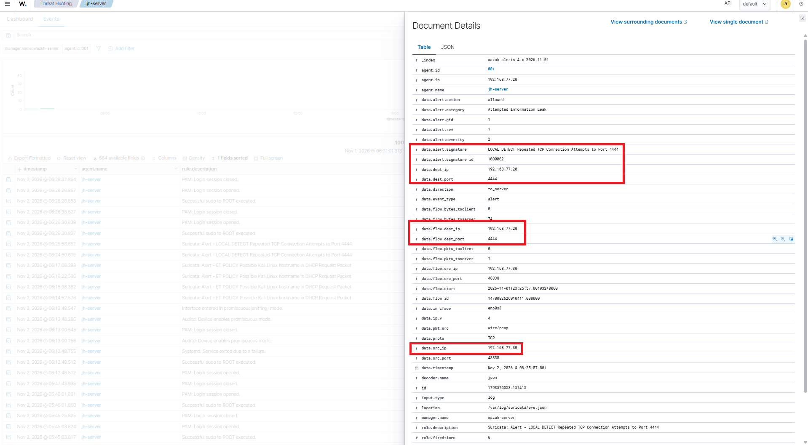

# 5. Suspicious Network Activity Detection

## 1. Tujuan

Pengujian ini bertujuan memvalidasi kemampuan Suricata dalam mendeteksi koneksi TCP dari mesin pengujian Kali Linux menuju port `4444` pada server Ubuntu, serta memastikan event alert diteruskan ke Wazuh untuk pemantauan terpusat.

Pengujian dilakukan dalam lingkungan VirtualBox terisolasi. Aktivitas yang dilakukan merupakan simulasi terkontrol, bukan bukti adanya serangan nyata.

## 2. Lingkungan Pengujian

| Komponen | Detail |
|---|---|
| Mesin sumber | Kali Linux |
| IP sumber | `192.168.77.30` |
| Server tujuan | Ubuntu Server (`jh-server`) |
| IP tujuan | `192.168.77.20` |
| Interface Suricata | `enp0s3` |
| Log Suricata | `/var/log/suricata/eve.json` |
| Wazuh Agent | `jh-server` (Agent ID `001`) |

## 3. Konfigurasi Rule Suricata

Rule lokal berikut ditambahkan pada `/etc/suricata/rules/local.rules`:

```suricata
alert tcp 192.168.77.30 any -> 192.168.77.20 4444 (msg:"LOCAL DETECT Repeated TCP Connection Attempts to Port 4444"; flags:S; flow:stateless; threshold:type both, track by_src, count 5, seconds 10; classtype:attempted-recon; sid:1000002; rev:1;)
```

Rule tersebut ditujukan untuk mengamati paket TCP SYN dari alamat sumber `192.168.77.30` menuju port tujuan `4444` pada `192.168.77.20`. Konfigurasi rule berhasil dimuat saat pengujian konfigurasi Suricata.

## 4. Prosedur Pengujian

Pada server Ubuntu, listener TCP dijalankan pada port `4444`:

```bash
nc -lvnp 4444
```

Dari Kali Linux, dilakukan percobaan koneksi ke port tersebut sebanyak lima kali:

```bash
for i in {1..5}; do nc -z -w 1 192.168.77.20 4444; done
```

Pada server Ubuntu, event alert diperiksa dari log EVE Suricata:

```bash
sudo grep -aF "Repeated TCP Connection Attempts" /var/log/suricata/eve.json | tail -5
```

## 5. Hasil Pengujian Suricata

Event alert ditemukan pada `/var/log/suricata/eve.json` dengan karakteristik berikut:

| Atribut | Hasil yang diamati |
|---|---|
| Event type | `alert` |
| Signature ID | `1000002` |
| Signature | `LOCAL DETECT Repeated TCP Connection Attempts to Port 4444` |
| Source IP | `192.168.77.30` |
| Destination IP | `192.168.77.20` |
| Destination port | `4444` |
| Protocol | `TCP` |
| Direction | `to_server` |
| Action | `allowed` |
| Severity | `2` |

Event yang diamati menunjukkan bahwa Suricata menghasilkan alert untuk koneksi TCP dari Kali Linux ke port `4444` pada server Ubuntu.

**Bukti alert Suricata**



## 6. Integrasi dengan Wazuh

Wazuh Agent pada server Ubuntu memantau file log `/var/log/suricata/eve.json`. Event Suricata diterima oleh Wazuh dan ditampilkan pada dashboard menggunakan rule Wazuh berikut:

| Atribut | Hasil |
|---|---|
| Wazuh Rule ID | `86601` |
| Level | `3` |
| Agent | `jh-server` |
| Agent ID | `001` |
| Agent IP | `192.168.77.20` |
| Suricata Signature ID | `1000002` |
| Source IP | `192.168.77.30` |
| Destination IP | `192.168.77.20` |
| Destination port | `4444` |
| Protocol | `TCP` |

**Daftar event pada dashboard Wazuh**



**Detail alert Wazuh**




## 7. Kesimpulan dan Batasan Validasi

Pengujian menunjukkan bahwa Suricata menghasilkan event alert dengan Signature ID `1000002` untuk koneksi TCP dari Kali Linux (`192.168.77.30`) menuju port `4444` pada server Ubuntu (`192.168.77.20`). Event tersebut juga terlihat pada dashboard Wazuh dengan Rule ID `86601` dan Level `3`.

Dengan demikian, deteksi event koneksi TCP ke port `4444` dan integrasi alert Suricata ke Wazuh telah teramati.

**Batasan validasi:**

- Rule dikonfigurasi dengan threshold `count 5, seconds 10`, tetapi bukti event yang tersedia muncul pada waktu yang terpisah sekitar 69 detik. Karena itu, pemenuhan threshold lima koneksi dalam sepuluh detik belum dapat dinyatakan tervalidasi.
- Nilai `action: allowed` menunjukkan bahwa trafik terdeteksi tetapi tidak diblokir oleh rule alert tersebut.
- Pengujian ini merupakan simulasi terkontrol di jaringan lab, bukan bukti serangan nyata.

## 8. Referensi Bukti

- `screenshots/16-wazuh-suspicious-network-events.png`
- `screenshots/17-wazuh-suspicious-network-details.png`
- `screenshots/18-suricata-suspicious-network-alert.png`
