# SOC Analyst Home Lab — Progress Log

## 1. Project Environment

Proyek ini merupakan implementasi home lab Security Operations Center (SOC) menggunakan Wazuh dan Suricata untuk memantau aktivitas endpoint serta jaringan.

Lingkungan laboratorium dibangun menggunakan VirtualBox dengan jaringan internal `192.168.77.0/24`.

## 2. Lab Components and Connectivity

| Komponen | Hostname | IP Address | Keterangan |
|---|---|---|---|
| Wazuh Manager | `wazuh-server` | `192.168.77.10` | Centralized monitoring dan alert management |
| Ubuntu Server | `jh-server` | `192.168.77.20` | Target endpoint dan Suricata sensor |
| Kali Linux | `kali` | `192.168.77.30` | Mesin pengujian |

**Detail lingkungan:**
- Virtualization: Oracle VirtualBox
- Network: Internal Network (`intnet`)
- Subnet: `192.168.77.0/24`
- Wazuh Agent: `4.14.9`
- Suricata: `8.0.4`
- Target OS: Ubuntu Server `20.04.5 LTS`
- Suricata interface: `enp0s3`
- Suricata EVE log: `/var/log/suricata/eve.json`

## 3. Validated Detection Results

### 3.1 SSH Authentication Failure Detection

Pengujian dilakukan dengan menjalankan percobaan autentikasi SSH yang sengaja gagal dari Kali Linux menuju Ubuntu Server.

Wazuh berhasil menerima event autentikasi dan menghasilkan alert berikut:

| Rule ID | Level | Deskripsi |
|---|---:|---|
| `2502` | 10 | PAM 2 more authentication failures |
| `5710` | 5 | Percobaan login menggunakan pengguna yang tidak ditemukan |
| `5503` | 5 | Kegagalan login PAM |

MITRE ATT&CK yang terasosiasi: `T1110` — Brute Force.

**Bukti pengujian:**

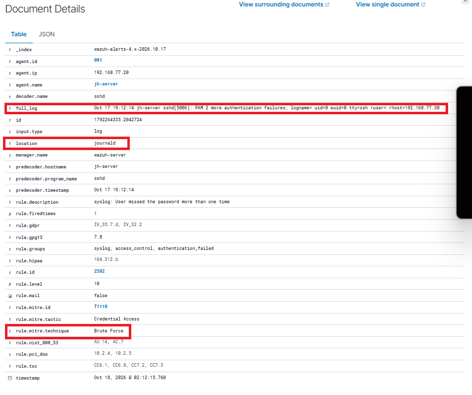

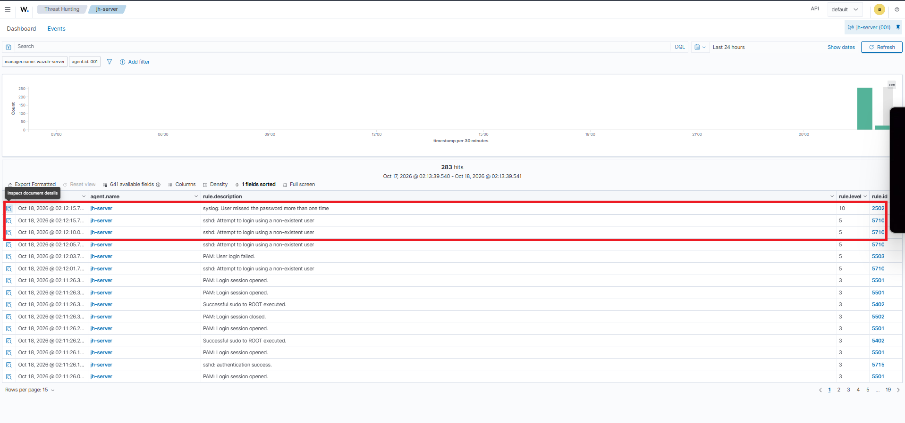

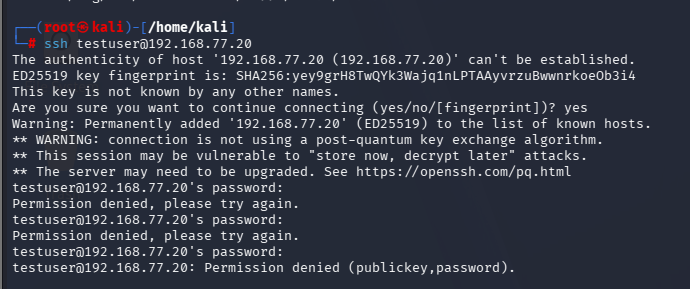

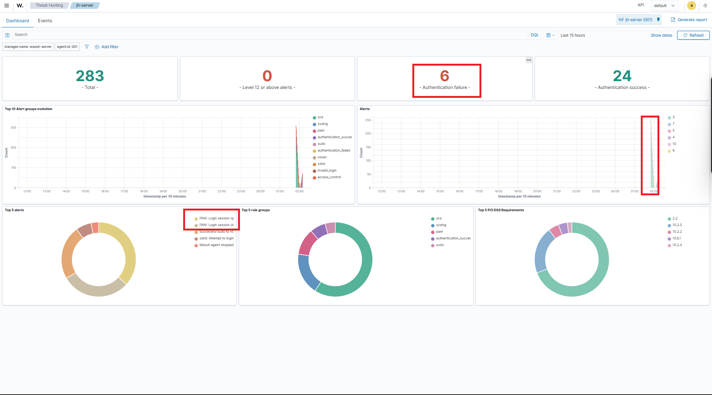

### 3.2 File Integrity Monitoring (FIM)

Pengujian File Integrity Monitoring dilakukan dengan membuat dan memodifikasi file pada endpoint Ubuntu Server.

Wazuh berhasil mendeteksi perubahan integritas file melalui alert berikut:

| Rule ID | Keterangan |
|---|---|
| `554` | File ditambahkan |
| `550` | Checksum file berubah |

**Bukti pengujian:**

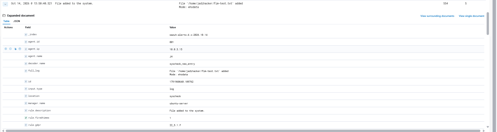

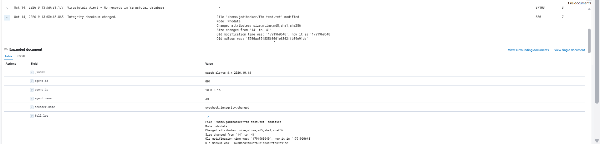

### 3.3 Network Intrusion Detection — TCP SYN Scan

Suricata dikonfigurasi untuk memantau trafik jaringan pada interface `enp0s3`. Wazuh Agent pada Ubuntu Server memantau file log Suricata `eve.json`.

Pengujian dilakukan dengan menjalankan Nmap SYN scan dari Kali Linux menuju Ubuntu Server:

```bash
nmap -sS -T3 --top-ports 100 192.168.77.20
```

Custom rule Suricata digunakan untuk mendeteksi pola TCP SYN scan dari alamat IP Kali Linux.

| Komponen | Hasil |
|---|---|
| Suricata Signature ID | `1000001` |
| Signature | `LOCAL DETECT Kali Linux TCP SYN Scan` |
| Source IP | `192.168.77.30` |
| Destination IP | `192.168.77.20` |
| Wazuh Rule ID | `86601` |
| Wazuh Level | 3 |

Alert berhasil diterima oleh Wazuh Manager melalui integrasi log Suricata.

**Bukti pengujian:**

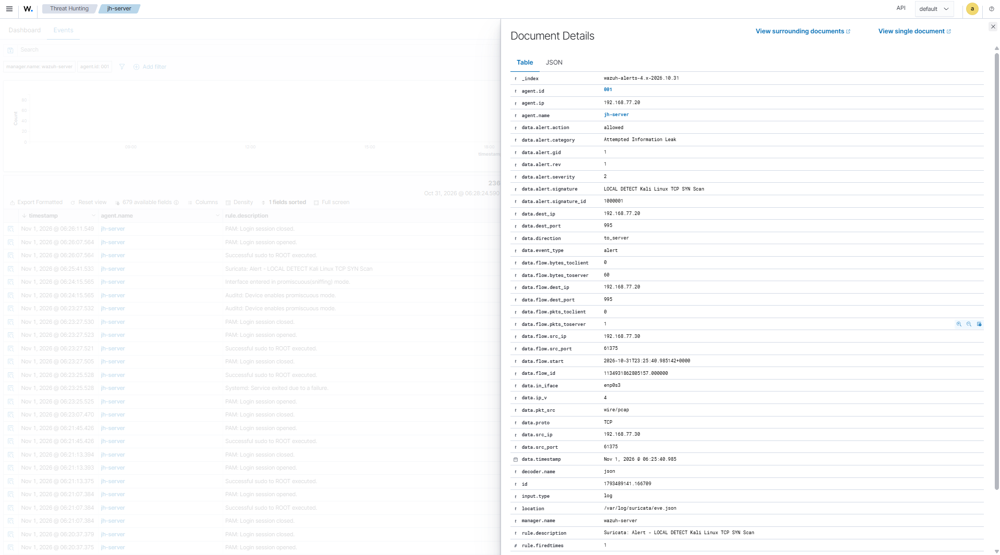

Pengujian ini merupakan simulasi pemindaian port terkontrol. Alert menunjukkan aktivitas terdeteksi, bukan berarti trafik berhasil diblokir.

### 3.4 IOC / Suspicious File Hash Detection

Pengujian dilakukan dengan membuat file simulasi pada Ubuntu Server dan mencocokkan SHA-256 hash file tersebut dengan daftar IOC lokal.

Script `check-ioc.sh` digunakan untuk menghitung hash dan membandingkannya dengan daftar hash pada `ioc-hashes.txt`.

Hasil pengujian terdiri dari dua kondisi:

- **Positive match:** hash file cocok dengan daftar IOC dan menghasilkan pesan `IOC_MATCH`.
- **Negative match:** hash file tidak cocok dan menghasilkan pesan `NO_MATCH`.

Wazuh Agent memantau log `/var/log/ioc-lab/hash-detection.log`. Custom rule pada Wazuh Manager menggunakan konfigurasi berikut:

| Rule ID | Level | Deskripsi |
|---|---:|---|
| `100320` | 10 | IOC Detection: File SHA256 matches local IOC list |

Alert berhasil diterima oleh Wazuh Manager dengan informasi agent `jh-server`, alamat IP `192.168.77.20`, serta hash file yang cocok dengan daftar IOC.

**Bukti pengujian:**

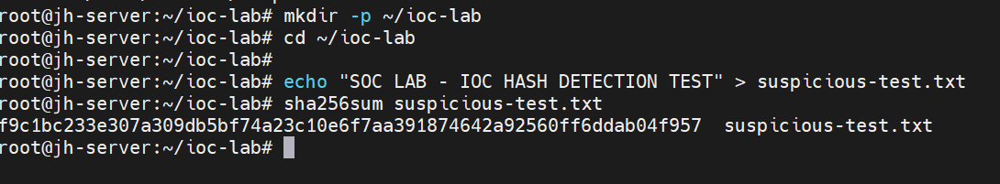

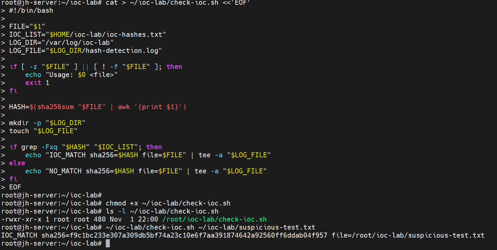

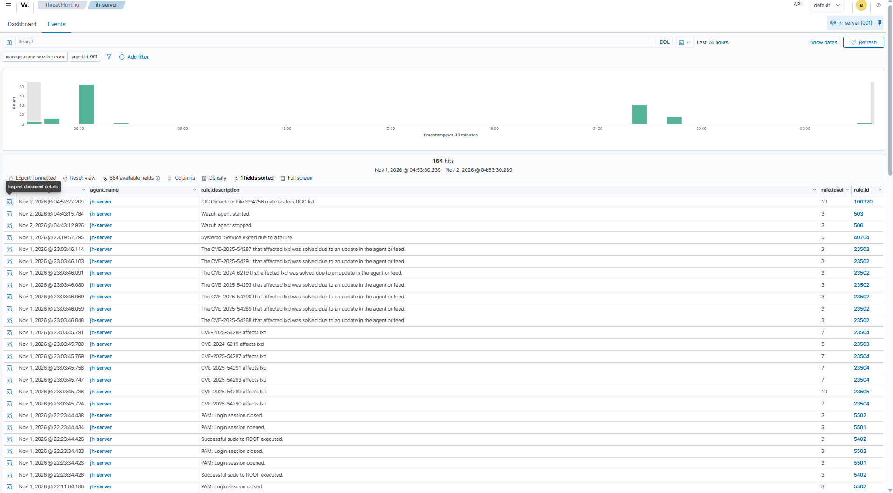

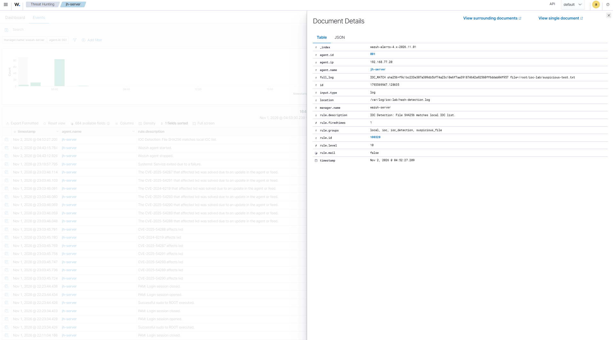

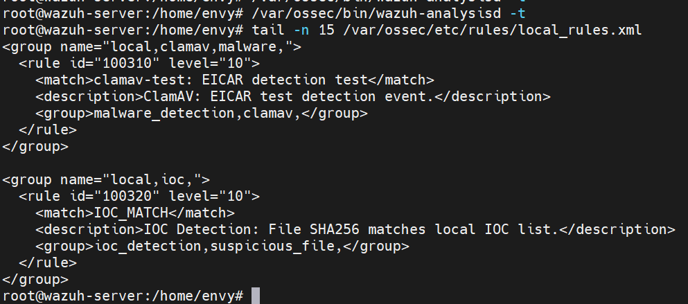

**Catatan:** hash yang digunakan merupakan IOC simulasi yang dibuat sendiri untuk keperluan pengujian. Hash tersebut bukan indikator malware yang telah diverifikasi dan file pengujian bukan malware.

## 4. Malware Detection — In Progress

Pengujian malware detection menggunakan ClamAV pada Ubuntu Server masih dalam proses.

Komponen yang telah disiapkan:

- ClamAV telah dipasang pada Ubuntu Server.
- File uji EICAR telah dibuat sebagai test file antivirus yang tidak berbahaya.
- Wazuh Agent telah dikonfigurasi untuk memantau `/var/log/clamav/eicar-scan.log`.
- Custom Wazuh rule `100310` telah dibuat untuk mengenali event pengujian ClamAV.
- Konfigurasi rule telah divalidasi menggunakan `wazuh-analysisd -t` dan `wazuh-logtest`.
- Event uji manual berhasil menghasilkan alert Wazuh Rule ID `100310`, Level 10.

**Kendala:**

Database signature ClamAV belum berhasil diperbarui karena pembatasan akses dan cooldown dari server pembaruan database.

**Status validasi:**

Integrasi event log manual dengan Wazuh telah berhasil diuji. Namun, deteksi hasil pemindaian EICAR secara langsung oleh ClamAV belum tervalidasi. Oleh karena itu, skenario malware detection masih berstatus *In Progress*.

## 5. Outstanding Items

Beberapa pekerjaan yang masih direncanakan atau membutuhkan validasi lanjutan:

1. Menyelesaikan pembaruan database ClamAV dan memvalidasi pemindaian EICAR secara langsung.
2. Menambahkan atribusi path file yang lebih spesifik pada hasil pengujian FIM.
3. Mengeksplorasi konfigurasi FIM Who-data.
4. Meninjau peringatan terkait audit event dispatch.
5. Mengimplementasikan dan menguji Wazuh Active Response.
6. Melengkapi dokumentasi investigasi insiden berdasarkan alert yang telah dihasilkan.
7. Mengembangkan skenario Suspicious Network Activity yang berbeda dari pengujian TCP SYN scan sebelumnya.

## 6. Security Notes

- Seluruh pengujian dilakukan dalam lingkungan VirtualBox terisolasi menggunakan jaringan internal.
- Percobaan login SSH gagal dan pemindaian Nmap merupakan aktivitas simulasi terkontrol.
- Pengujian IOC menggunakan hash buatan sendiri, bukan hash malware yang telah diverifikasi.
- File EICAR merupakan file uji antivirus standar dan bukan malware aktif.
- Alert yang dihasilkan menunjukkan aktivitas terdeteksi oleh sistem monitoring. Alert tidak otomatis berarti aktivitas berhasil diblokir.
- Hasil pengujian hanya dinyatakan tervalidasi apabila event atau alert terkait telah diamati pada sistem yang bersangkutan.

## 7. Summary

Implementasi SOC home lab telah berhasil memvalidasi beberapa skenario deteksi menggunakan Wazuh dan Suricata.

Skenario yang telah tervalidasi:

- SSH Authentication Failure Detection.
- File Integrity Monitoring.
- Network Intrusion Detection melalui TCP SYN Scan.
- IOC / Suspicious File Hash Detection.

Integrasi Suricata dan Wazuh telah berhasil menghasilkan alert dari aktivitas jaringan yang disimulasikan. Wazuh juga berhasil menerima event autentikasi, perubahan integritas file, dan pencocokan hash IOC.

Skenario Malware Detection menggunakan ClamAV masih dalam proses karena pembaruan database signature belum berhasil diselesaikan.

Pengembangan selanjutnya difokuskan pada penyelesaian pengujian ClamAV, Active Response, dan skenario deteksi aktivitas jaringan tambahan.
